[English](README.md) | **Español**

# El hackeo de US$6.300 millones a Binance: lo que le hizo al mercado cripto, y lo que no


**Página:** https://rxyxs.github.io/binance-hack-market-impact/ (incluye velas interactivas de Binance)

El 29 de octubre de 2026 a las 20:05 UTC, las wallets calientes de Binance en diez blockchains
empezaron a enviar monedas a un atacante: 18.270 BTC, 200.630 ETH, 233 millones de XRP, 970.500 SOL y
unos 3.400 millones de dólares en stablecoins, **6.360 millones de dólares** en total según TRM Labs, el
mayor robo cripto registrado. Bitcoin cayó bajo 77.000 dólares esa noche y BNB perdió 7%. Los
titulares culparon al hackeo.

Pero cinco minutos antes del primer envío había cerrado la bolsa de Nueva York, y Amazon e Intel
publicaron resultados que hundieron los futuros del Nasdaq. Bitcoin además venía 16% bajo su máximo
de enero, y el Brent estaba sobre 110 dólares por la guerra con Irán. Así que desarmé la noche minuto
a minuto con precios y cada transacción de Binance, Coinbase, OKX y Yahoo Finance; la comparé con
todos los hackeos a exchanges de 30 millones de dólares o más desde 2011; y probé si las noticias, la
guerra, la macro y los datos on-chain pueden pronosticar el precio de las criptomonedas.

Todo corre con datos públicos que no piden clave de API, y cada cifra de abajo sale de correr el código.

## Qué pasó

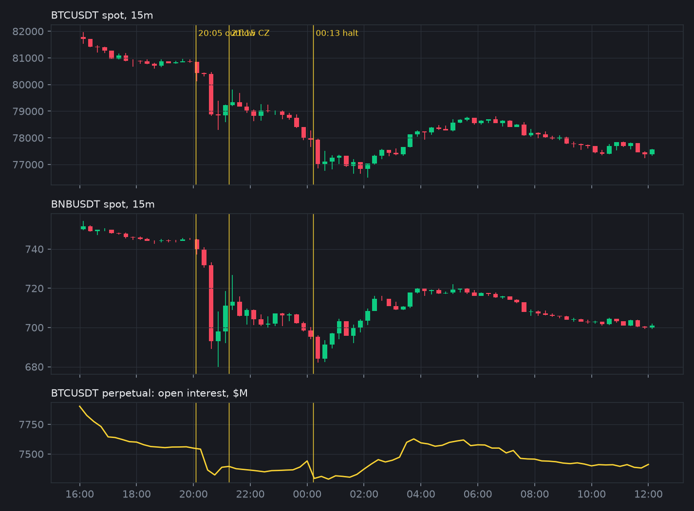

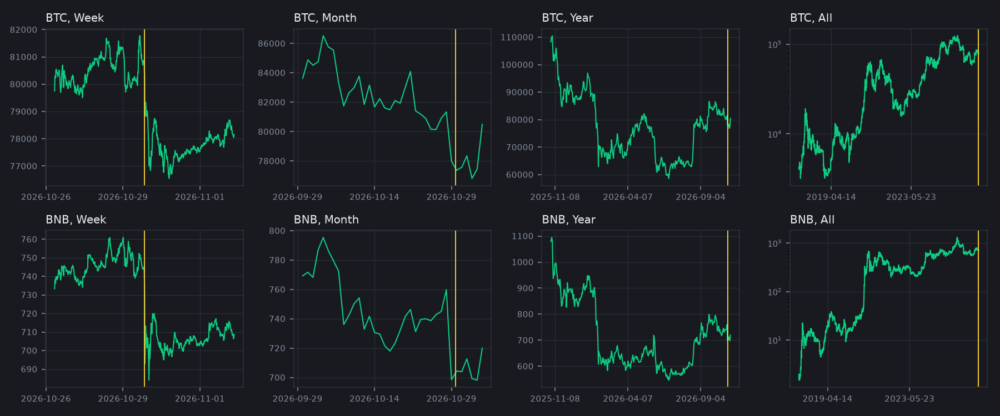

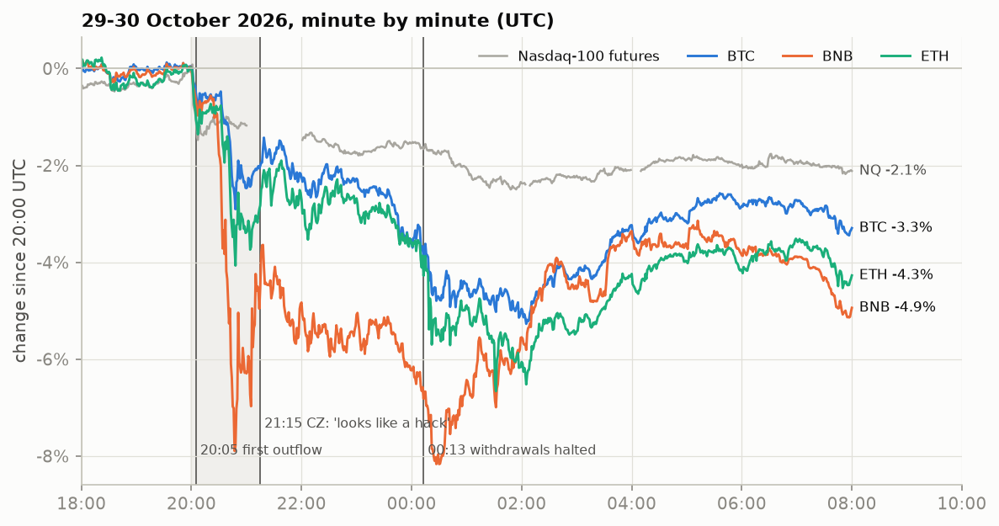

| Desde las 20:00 UTC del 29 oct hasta... | BTC | ETH | BNB | Futuros Nasdaq-100 |
|---|---|---|---|---|
| 21:15, cuando el fundador de Binance escribió "parece un hackeo" | -2,0% | -2,9% | -4,6% | -1,2% |
| 00:13, cuando se suspendieron los retiros | -4,0% | -4,4% | -7,1% | -1,7% |
| el cierre del 2 de noviembre | -5,1% | -3,6% | -6,3% | -4,7% |

Los cambios de esta tabla y de los hallazgos 1 a 6 son retornos logarítmicos, que se suman entre
ventanas; a estos tamaños difieren en menos de 0,2 puntos de los cambios porcentuales simples.

## Hallazgos

**1. La mayor parte de la caída de Bitcoin fue el Nasdaq, no el hackeo.** Ajusté los retornos de
cinco minutos de Bitcoin a los futuros del Nasdaq-100, el índice del dólar y el oro durante la
semana previa (R² 0,37) y usé ese ajuste para predecir cada ventana. Desde las 20:00 del 29 de octubre
hasta el cierre del 2 de noviembre, Bitcoin cayó 5,1%. La caída tecnológica predice **3,7 puntos** de
eso, lo que deja **-1,4 puntos** como anormales (con retornos de 30 minutos en vez de cinco: 3,4
explicados, -1,7 anormales). El efecto propio del hackeo fue fuerte y corto: -1,2 puntos antes de
cualquier declaración, otros -1,5 mientras el exchange lo admitía, y luego +1,7 de vuelta en las
primeras seis horas de la suspensión de retiros.

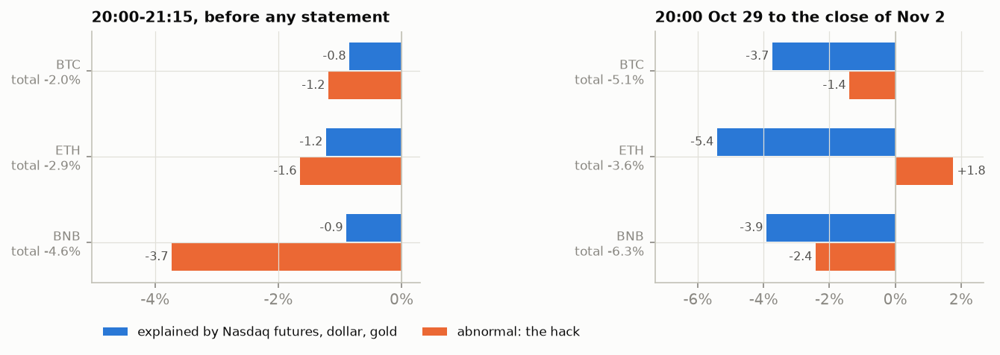

**2. El mercado lo supo antes de que Binance dijera nada.** Una alarma simple sobre el retorno de
15 minutos de BNB contra Bitcoin, calibrada para sonar como máximo una vez al mes (umbral fijado en 60
días y probado en los 30 siguientes, donde **no dio ninguna falsa alarma**), saltó a las **20:33 UTC**:
28 minutos después del primer envío y **42 minutos antes** del post de Changpeng Zhao. En los 75
minutos previos a ese post, BNB transó **55 veces** su volumen normal para esa hora, con 43% de compras
iniciadas por el comprador (lo normal es 50%). La misma alarma, sin cambios, sobre el hackeo de Binance
de mayo de 2019 (7.000 BTC) saltó a las 23:48, **14 minutos después** del anuncio del exchange. En 2019
el mercado se enteró por el anuncio; en 2026, por la blockchain.

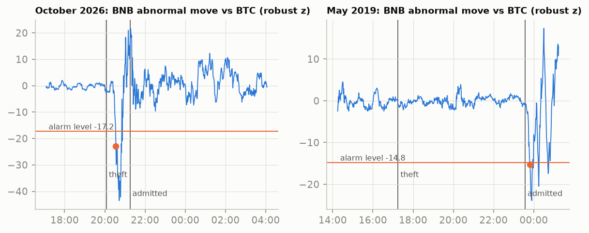

**3. Se castigó al token del propio Binance. Nadie apostó a que el ladrón vendería.** Si el
mercado hubiera temido que el atacante vendiera 18.270 BTC o 233 millones de XRP (tres días de volumen
de XRP en Binance), las monedas de las cadenas vaciadas tendrían que haber caído más que el resto. No
pasó: desde las 20:00 hasta la reapertura de retiros, su retorno neto de beta por Bitcoin fue **+3,6
puntos** en promedio contra **+3,2** de 13 monedas grandes cuyas cadenas no se tocaron (permutación p =
0,81; en los primeros 75 minutos p = 0,17, con las robadas cayendo *menos*). BNB fue la excepción con
-2,1 puntos, y el 2 de noviembre seguía en -1,7. TRX subió 8% durante el hackeo y después lo devolvió todo.

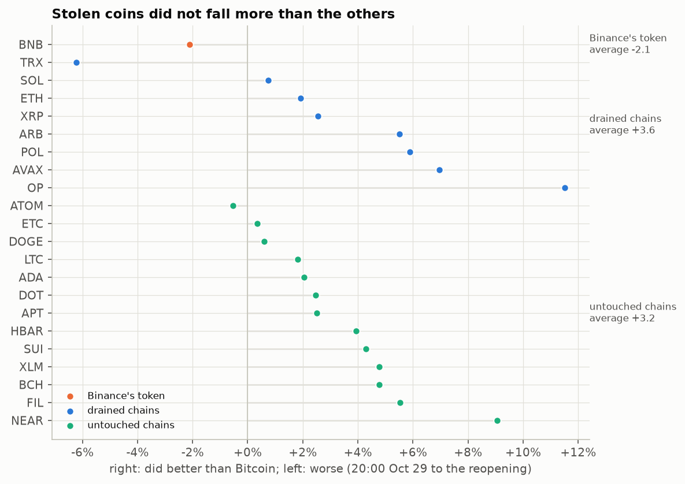

**4. La venta vino en órdenes chicas.** Entre las 20:00 y las 06:00, los tomadores vendieron 176
millones de dólares más de BTC de los que compraron en Binance spot, contra un flujo casi equilibrado
en las siete noches previas. Las órdenes de menos de 10.000 dólares explican 123 millones (70%). Las de
10.000 a 100.000, que la noche anterior fueron compradoras netas, quedaron casi planas. Ojo: un trade
agregado es una orden ejecutada a un precio, y los algoritmos parten órdenes grandes en pedazos, así
que chico no es lo mismo que minorista.

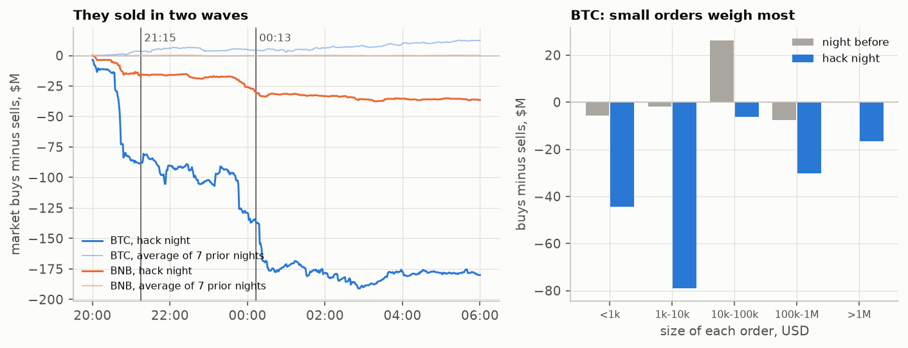

**5. Una corrida contra el exchange, pero ordenada.** DefiLlama sigue las monedas en las wallets
que Binance publica. Valorando el cambio diario en *cantidades* de cada moneda al precio de ese día
se separan los flujos reales de los movimientos de precio: **-5.950 millones** el 29 de octubre (el
robo mismo: salieron 16.000 BTC y 230 millones de XRP, cerca de los 18.270 BTC y 233 millones de XRP
que TRM reportó robados),
nada mientras los retiros estuvieron suspendidos, y luego **-6.140 millones** el 1 de noviembre y
**-2.550 millones** el 2. Son 8.700 millones de dólares retirados por clientes en dos días, 6% de los
144.900 millones que había antes del hackeo. Durante las 54 horas de suspensión, los precios de
Binance quedaron **entre 3 y 10 puntos básicos sobre** Coinbase y OKX (mediana de BTC contra Coinbase
+8,6 pb, contra +0,9 la semana previa): el mercado valoraba un dólar atrapado en Binance en unos
99,9 centavos.

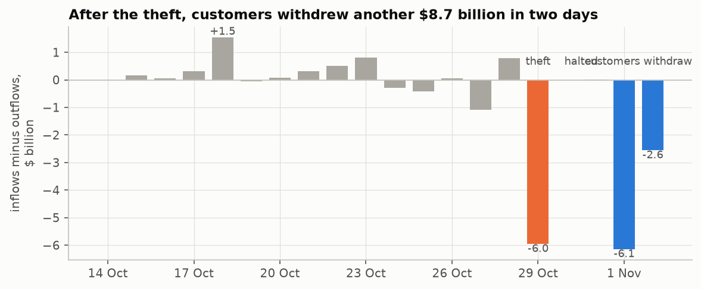

**6. Las acciones cripto cayeron más o menos lo que su exposición predecía.** Con Bitcoin medido de un
cierre de Nueva York al siguiente (-4,95% para la sesión del 30 de octubre, porque el hackeo partió
después del cierre del 29) y el Nasdaq-100 cayendo 3,5%, un modelo de dos factores ajustado en las 120
sesiones previas deja a Coinbase en -3,3% anormal (t = -1,2), Robinhood -0,9%, Circle -0,8% y Strategy
+2,1%: todos dentro del ruido diario normal. No hubo contagio a las empresas cripto en bolsa, ni
tampoco fuga hacia el competidor regulado. Medir Bitcoin de medianoche a medianoche habría mostrado
un -6,7% falso para Coinbase.

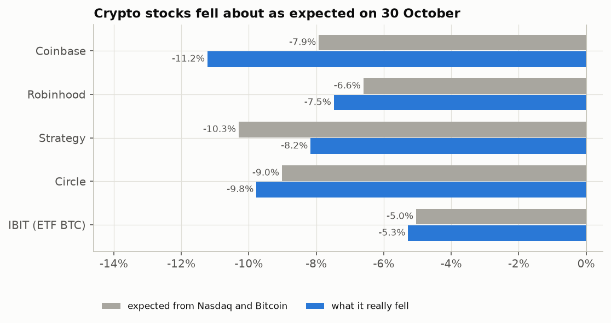

**7. Quince años de hackeos a exchanges: sin efecto promedio sobre Bitcoin, y este solo destaca
por tamaño.** En los 36 hackeos a exchanges centralizados de 30 millones de dólares o más del registro
de DefiLlama desde 2011, el retorno anormal estandarizado de Bitcoin en el día del incidente y el
siguiente promedia -0,17 (placebo p = 0,15 contra fechas al azar); la mitad son negativos. El hackeo a
Binance es el 3° de 36 (-5,5% anormal en dos días, -1,96 desviaciones), un movimiento que igualan o
superan el 3,5% de todas las ventanas de dos días. El tamaño del robo casi no predice la reacción
(correlación -0,22).

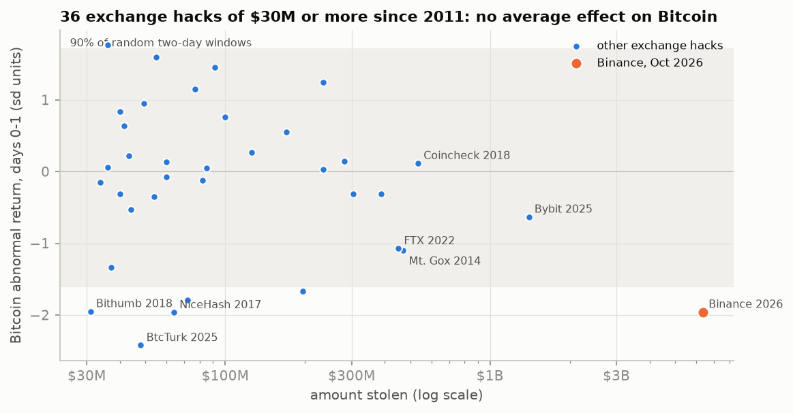

**8. ¿De verdad había tendencia alcista?** El 28 de octubre Bitcoin cerró en 81.344 dólares. Había
subido 43% en el tercer trimestre (su promedio de 50 días, 81.943, estaba sobre el de 200, 73.111), pero
en octubre ya iba -2,7%, en el año -7,2% y **16% bajo su máximo de enero** de 96.952 dólares. El Brent
estaba en 115 dólares después de ocho meses de guerra en el Golfo y la tasa a 10 años de EE.UU. cerca de
5%. El repunte fue real, pero se había frenado antes del hackeo.

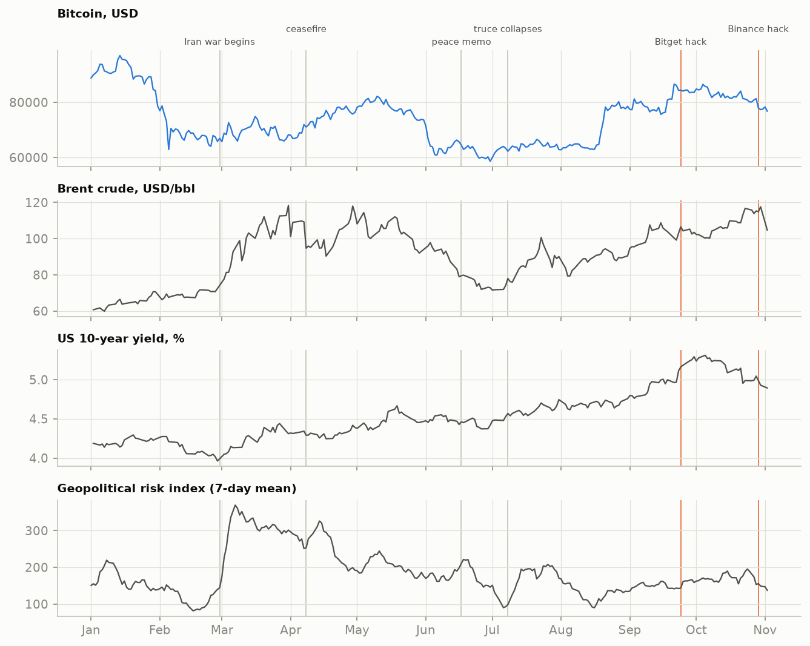

**9. ¿Puede el machine learning pronosticar el precio con las noticias?** **El precio no, y las noticias no aportan nada.** Armé un panel diario de BTC, ETH, BNB, XRP y SOL desde 2019 con 65 variables en ocho grupos: precio y volumen, financiamiento de futuros, bolsa, tasas, dólar y petróleo, índices de noticias de guerra y política (riesgo geopolítico, incertidumbre de política), sentimiento y atención (Fear & Greed, Wikipedia), oferta on-chain (hash rate, stablecoins, reservas de Binance), el registro de hackeos y el calendario, cada una con el rezago con que se publica. Cada mes, de enero de 2022 a noviembre de 2026, ridge, LightGBM, LightGBM por cuantiles y una red MLP se reentrenaron con lo conocido ese día y pronosticaron el mes siguiente: 8.830 días-moneda.

| Objetivo | Referencia | Resultado fuera de muestra |
|---|---|---|
| Retorno de mañana | "sin cambio" | R² contra cero: LightGBM -0,6%, ridge -1,1%, MLP -1,4%, media histórica -0,3%; aciertan la dirección 49,4% a 51,2% de los días |
| Retorno a 7 días | "sin cambio" | R² LightGBM -2,0%, ridge -3,8% |
| Volatilidad de la semana siguiente | HAR (último día, semana y mes) | HAR explica 19,3% de la volatilidad en logaritmo; LightGBM 20,3%, 1,2% menos error, Diebold-Mariano p = 0,28 |

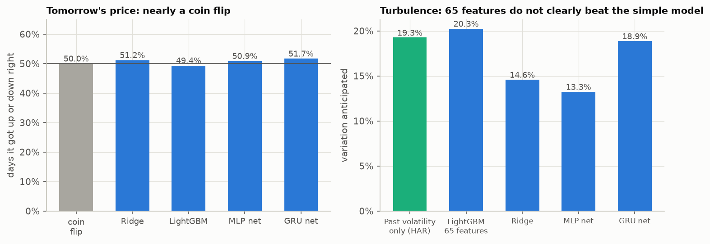

- Una estrategia de comprar o quedarse fuera según el signo de LightGBM perdió contra mantener en las cinco monedas (BTC -48% contra +61% manteniendo, con 10 pb por cambio).
- La MLP entrenó al menos 100 épocas en cada reentrenamiento trimestral y guardó su mejor checkpoint de validación. En retornos ese checkpoint siempre estuvo entre la época 1 y la 10 (mediana 1): lo que aprendía después de las primeras épocas era ruido.
- Un GRU sobre los últimos 20 días, con al menos 100 épocas por reentrenamiento trimestral, early stopping y checkpoint desde la época 100 (mejor época 100 a 126 en retornos), tampoco ayudó: R² -1,7% a un día y -12,3% a 7 días, dirección correcta en 51,7% de los días; en volatilidad, como corrección de HAR, 18,9% contra 19,3% (Diebold-Mariano p = 0,78). Su mejor época queda pegada al piso de 100: entrenar más solo agregó ruido.
- Agregando un grupo a la vez a precio y volumen (reentrenamiento trimestral), ningún grupo mueve el error de mañana en más de 0,7%. En volatilidad, **cada grupo de noticias empeora el pronóstico**: bolsa y tasas +4,2%, on-chain +3,5%, registro de hackeos +3,2%, sentimiento +2,7%, índices de guerra y política +2,4% más error; solo el financiamiento de futuros ayuda (-0,3%). Lo que la guerra y las noticias le hicieron a los precios ya estaba en los precios cuando salieron los índices.
- Las bandas de 90% son honestas en promedio (cubrieron 89,2% de los movimientos de un día y 86,2% de los de 7 días) y no vieron venir el hackeo: para el 29 de octubre la banda de BTC era -3,0% a +3,7% y cayó 4,1%; la de BNB -3,2% a +4,2% y cayó 8,1%. Las cinco monedas cerraron bajo su banda.

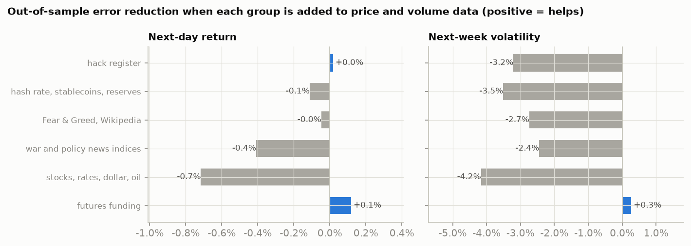

**10. El pronóstico de hoy.** Reentrenados con todo lo resuelto al cierre del 2 de noviembre de 2026 y aplicados a ese día:

| Moneda | Cierre 2 nov | 3 nov: mediana (banda 90%) | 9 nov: mediana (banda 90%) | Volatilidad diaria esperada la próxima semana (últimos 30 días) |
|---|---|---|---|---|
| BTC | 76.816 | 76.820 (73.987 - 79.192) | 76.627 (68.088 - 86.972) | 1,87% (1,52%) |
| ETH | 2.253 | 2.253 (2.167 - 2.329) | 2.252 (1.997 - 2.538) | 2,07% (1,90%) |
| BNB | 699,25 | 699,18 (670,40 - 721,39) | 698,01 (619,80 - 786,69) | 2,12% (2,11%) |
| XRP | 1,2502 | 1,2498 (1,2016 - 1,2917) | 1,2494 (1,1082 - 1,4018) | 2,11% (2,33%) |
| SOL | 91,98 | 92,05 (87,62 - 95,53) | 92,02 (81,12 - 105,07) | 2,69% (2,21%) |

Las medianas son "sin cambio", como dice la evaluación que deben ser; la información está en el ancho de la banda. El modelo de volatilidad espera más turbulencia que en los últimos 30 días para BTC, ETH y SOL. En su descomposición TreeSHAP dominan las variables de precio y volumen; los índices de guerra y política y el registro de hackeos mueven el pronóstico menos de 0,01 en volatilidad logarítmica cada uno. Una GitHub Action compara este pronóstico con cada nuevo cierre diario; el registro está en la [página](https://rxyxs.github.io/binance-hack-market-impact/).

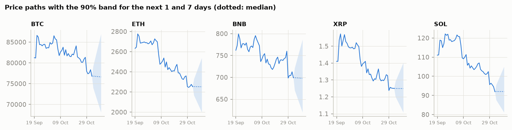

## Por año

Bitcoin en Binance spot (solo el par BTCUSDT; Binance también lista BTC contra otras stablecoins):

| Año | Retorno | Volatilidad anual | Caída máxima | Volumen, miles de millones US$ | Trades/día, miles | Iniciado por comprador |
|---|---|---|---|---|---|---|
| 2017 (desde el 17 ago) | +221,9% | 110% | -34,9% | 7 | 31 | 51,9% |
| 2018 | -73,0% | 84% | -81,2% | 96 | 239 | 51,3% |
| 2019 | +94,3% | 68% | -49,4% | 121 | 359 | 50,9% |
| 2020 | +302,0% | 81% | -53,6% | 286 | 859 | 48,8% |
| 2021 | +59,8% | 81% | -53,1% | 1.154 | 1.838 | 49,2% |
| 2022 | -64,2% | 64% | -66,9% | 1.199 | 3.289 | 49,6% |
| 2023 | +155,6% | 44% | -20,0% | 920 | 2.566 | 49,5% |
| 2024 | +121,3% | 53% | -26,2% | 850 | 2.774 | 49,6% |
| 2025 | -6,3% | 42% | -32,0% | 767 | 3.736 | 48,4% |
| 2026 (al 2 nov) | -12,4% | 44% | -39,5% | 401 | 3.561 | 49,4% |

Dinero robado en cripto por año (registro de hackeos de DefiLlama, todos los objetivos):

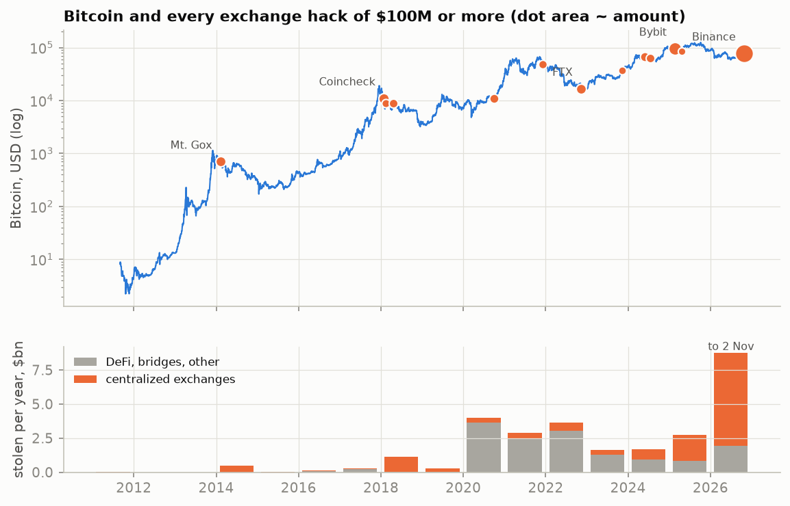

2026 ya es el peor año registrado con **8.780 millones de dólares** al 2 de noviembre, 6.820 millones de
ellos en exchanges centralizados; el hackeo a Binance es 72% del año.

## Método

```
data.binance.vision ─ velas diarias 2017-2026 (22 monedas), velas de 1 minuto y cada transacción
                      del 22 oct al 2 nov, futuros perpetuos, interés abierto, financiamiento
Coinbase, OKX        ─ precios de 1 minuto, misma ventana, para comparar exchanges
Yahoo Finance        ─ 1 minuto de futuros del Nasdaq-100, dólar, oro, petróleo y acciones cripto
                      (congelados en data/snapshot/: Yahoo guarda velas de minuto solo 30 días)
Bitstamp             ─ Bitcoin diario desde 2011 (hackeos anteriores a Binance)
DefiLlama            ─ registro de 1.336 hackeos; tenencias de Binance por token; stablecoins
FRED, GPR Iacoviello ─ tasas, expectativas de inflación, spreads de crédito, incertidumbre de
                      política, y un índice diario de riesgo geopolítico hecho con noticias de guerra
alternative.me, Wikimedia, blockchain.com ─ Fear & Greed, visitas a Wikipedia, hash rate
        │
        ├── annual.py      retornos, volumen y compras por año; hackeos por año
        ├── eventstudy.py  36 hackeos a exchanges, retornos anormales estandarizados, fechas placebo
        ├── intraday.py    la noche: trayectorias, hackeo vs Nasdaq, corte transversal, flujos,
        │                  exchanges, interés abierto, reservas, acciones cripto
        ├── detector.py    alarma con datos de mercado, calibrada en 60 días, probada en 30, y en 2019
        ├── features.py    panel diario: 65 variables en 8 grupos, cada una con su rezago de publicación
        ├── forecast.py    walk-forward mensual 2022-2026: ridge, LightGBM, LightGBM por cuantiles con
        │   nn.py          bandas conformales, MLP; pruebas Diebold-Mariano; ablación por grupo
        └── nowcast.py     los mismos modelos reentrenados con todo, aplicados al último día
```

Las horas de cada evento vienen de la reconstrucción on-chain de TRM Labs y de la cronología pública,
con fuente por fila en [`data/catalog/hack_timeline.csv`](data/catalog/hack_timeline.csv). Las
variables de noticias son el índice de riesgo geopolítico de Caldara e Iacoviello (artículos sobre
guerra y terrorismo en diez diarios), el índice de incertidumbre de política de Baker, Bloom y Davis,
las visitas a Wikipedia, el índice Fear & Greed y el registro de hackeos de DefiLlama. GDELT fue la
primera opción para noticias, pero su archivo tiene un hoyo justo sobre el hackeo: cuando lo consulté
el 3 de noviembre de 2026, los artículos que monitoreaba bajaban de unos 150.000 diarios a 2.000-5.000
desde el 26 de octubre, y faltaban los días del 28 de octubre al 2 de noviembre.

## Límites

- Un solo evento. Los hallazgos de minuto describen este hackeo; lo que generaliza es el estudio de eventos.
- El modelo del Nasdaq explica 37% de la varianza de cinco minutos de Bitcoin en una semana tranquila.
  En una caída los betas pueden subir, lo que atribuiría aún más de la caída al Nasdaq, no menos.
- Los montos robados y las horas vienen de TRM Labs y de la prensa; Binance no ha publicado un informe
  técnico. DefiLlama fecha los hackeos por día, no por hora, así que el estudio de eventos usa ventanas de dos días.
- DefiLlama solo ve las wallets que Binance publicó, y FRED ahora entrega solo tres años del spread
  high-yield de ICE, así que esa variable falta antes de 2023.
- Nada de esto es una recomendación de inversión. La sección de pronóstico muestra lo poco que se puede
  predecir el precio diario, que es lo contrario de una señal para operar.

## Reproducir

```bash
pip install -r requirements.txt
PYTHONPATH=src python -m bhack.run      # descarga ~300 MB, luego unos 45 minutos con 16 núcleos
pytest -q
```

El pipeline escribe [`reports/results.json`](reports/results.json), las figuras en `docs/img/` y la
página en `docs/index.html`.

## Fuentes

- TRM Labs, [North Korea steals USD 6.36 billion from Binance](https://www.trmlabs.com/resources/blog/north-korea-steals-usd-6-36-billion-from-binance-in-the-largest-hack-in-history) (cronología on-chain y montos)
- [2026 Binance hack](https://en.wikipedia.org/wiki/2026_Binance_hack), Wikipedia; [cronología de CryptoTicker](https://cryptoticker.io/en/crypto-crash-binance-hack-timeline-liquidations/); [cronología de StealthEX](https://stealthex.io/blog/binance-hack-everything-we-know-about-the-6-3b-theft/)
- [Blog en vivo de mercados de CNBC, 29-30 de octubre de 2026](https://www.cnbc.com/2026/10/29/stock-market-today-live-updates.html); [2026 Strait of Hormuz crisis](https://en.wikipedia.org/wiki/2026_Strait_of_Hormuz_crisis), Wikipedia
- Caldara e Iacoviello, [Geopolitical Risk Index](https://www.matteoiacoviello.com/gpr.htm); [DefiLlama hacks](https://defillama.com/hacks); [datos públicos de Binance](https://data.binance.vision)

## Licencia

MIT, ver [LICENSE](LICENSE).
