**English** | [Español](README.es.md)

# The $6.3B Binance hack: what it did to crypto markets, and what it didn't


**Live page:** https://rxyxs.github.io/binance-hack-market-impact/ (includes interactive Binance candlestick charts)

At 20:05 UTC on 29 October 2026, Binance's hot wallets on ten blockchains began sending coins
to an attacker: 18,270 BTC, 200,630 ETH, 233 million XRP, 970,500 SOL and about $3.4 billion in
stablecoins, **$6.36 billion** in all according to TRM Labs, the largest crypto theft on record.
Bitcoin fell below $77,000 that night and BNB lost 7%. The headlines blamed the hack.

Five minutes before the first outflow, though, the New York stock market had closed, and Amazon
and Intel published earnings that sent Nasdaq futures down. Bitcoin had also lost 16% from its
January high, and Brent crude was above $110 because of the war with Iran. So I took the night apart, minute by
minute, with prices and every trade from Binance, Coinbase, OKX and Yahoo Finance; I compared it
with every exchange hack of $30 million or more since 2011; and I tested whether news, war,
macro and on-chain data can forecast crypto prices.

Everything here runs on public data that needs no API key, and every number below comes from
running the code.

## What happened

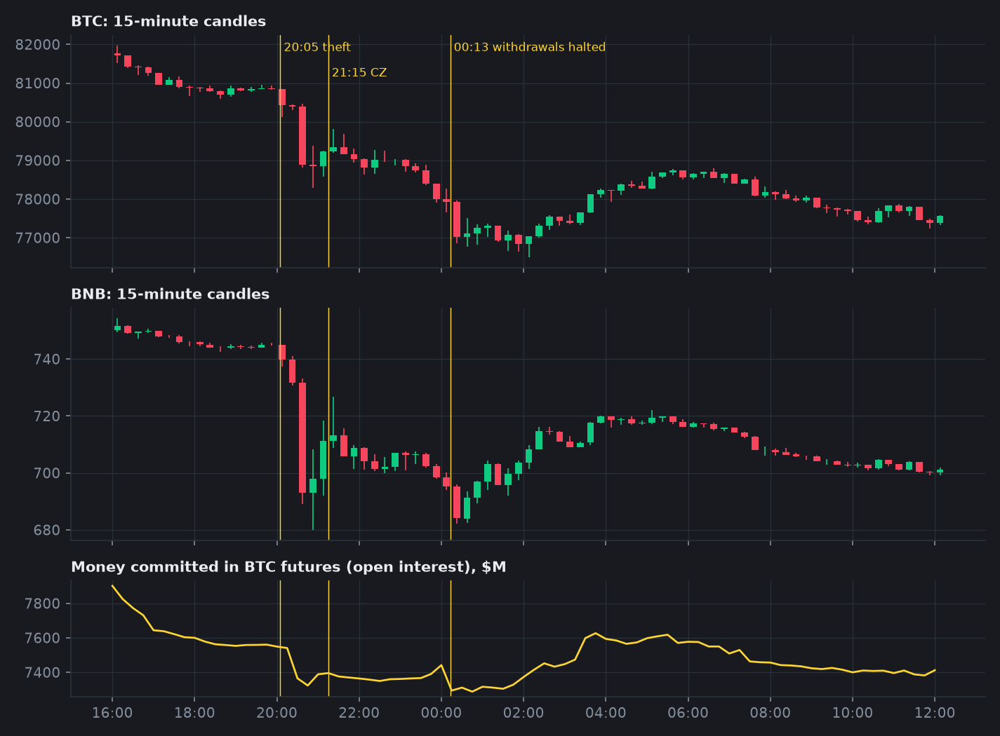

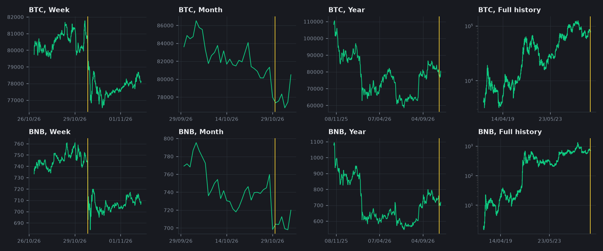

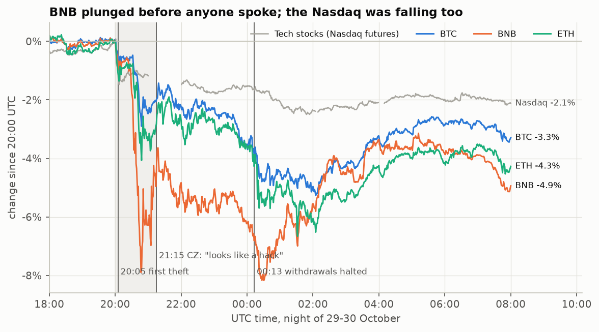

| From 20:00 UTC on 29 Oct to... | BTC | ETH | BNB | Nasdaq-100 futures |
|---|---|---|---|---|
| 21:15, when Binance's founder posted "does look like a hack" | -2.0% | -2.9% | -4.6% | -1.2% |
| 00:13, when withdrawals were halted | -4.0% | -4.4% | -7.1% | -1.7% |
| the close of 2 November | -5.1% | -3.6% | -6.3% | -4.7% |

The changes in this table and in findings 1 to 6 are log returns, which add up across windows; at
these sizes they are within 0.2 points of simple percentage changes.

## Findings

**1. Most of Bitcoin's fall was the Nasdaq, not the hack.** I fitted Bitcoin's five-minute
returns on Nasdaq-100 futures, the dollar index and gold during the week before (R² 0.37) and
used that fit to predict each window. From 20:00 on 29 October to the close of 2 November,
Bitcoin fell 5.1%. The tech sell-off predicts **3.7 points** of that, which leaves **-1.4 points** as
abnormal (with 30-minute returns instead of five: 3.4 explained, -1.7 abnormal). The hack's own
effect was sharp and short: -1.2 points before any statement, another -1.5 while the exchange
admitted it, and then +1.7 back during the first six hours of the withdrawal halt.

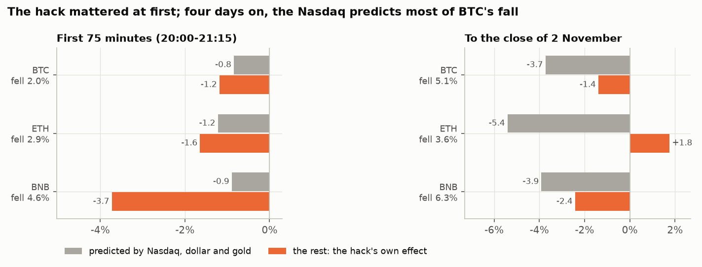

**2. The market knew before Binance said anything.** A simple alarm on BNB's 15-minute
return against Bitcoin, set so that it fires at most once a month (threshold calibrated on 60
days, then checked on the next 30, where it raised **no false alarms**), went off at **20:33 UTC**:
28 minutes after the first outflow and **42 minutes before** Changpeng Zhao's post. In the 75
minutes before that post, BNB traded **55 times** its usual volume for that hour with 43% of it
buyer-initiated (normally 50%). The same alarm, unchanged, on Binance's May 2019 hack (7,000
BTC) went off at 23:48, **14 minutes after** the exchange announced it. In 2019 the market learned from
the announcement; in 2026 it learned from the blockchain.

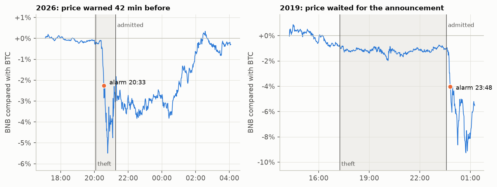

**3. Binance's own token was punished. Nobody priced a dump of the loot.** If traders
had feared the attacker selling 18,270 BTC or 233 million XRP (three days of Binance's XRP
volume), coins from the drained chains should have fallen more than the rest. They did not: from
20:00 to the reopening of withdrawals, their return net of beta times Bitcoin was **+3.6 points** on
average against **+3.2** for 13 large coins whose chains were untouched (permutation p = 0.81; in
the first 75 minutes p = 0.17, with the stolen coins falling *less*). BNB was the exception at
-2.1 points, and it still carried -1.7 points on 2 November. TRX rose 8% during the hack and then gave
it all back.

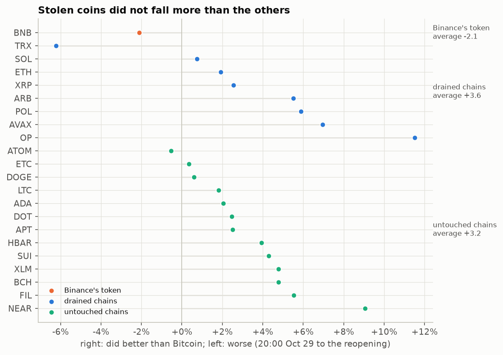

**4. The selling came in small orders.** From 20:00 to 06:00, takers sold $176 million more BTC
than they bought on Binance spot, against roughly balanced flow on the seven previous nights.
Orders under $10,000 account for $123 million of that (70%). Orders of $10k-100k, which were net buyers
the night before, were nearly flat. A caveat: an aggregated trade is one taker order filled at
one price, and algorithms split large orders into small pieces, so small is not the same as retail.

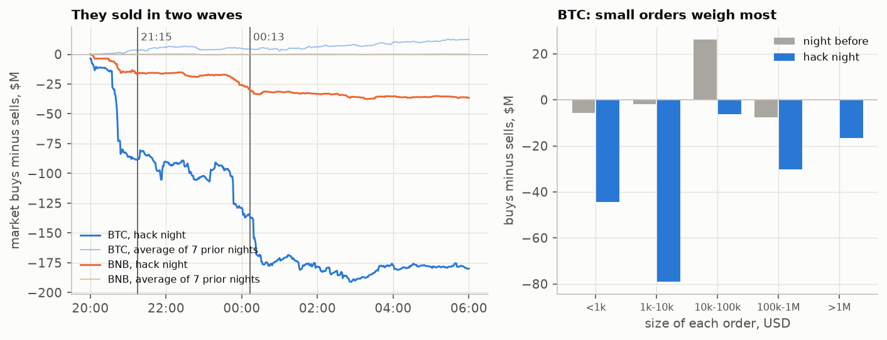

**5. A run on the exchange, but an orderly one.** DefiLlama tracks the coins on Binance's
published wallets. Valuing each day's change in coin *quantities* at that day's prices separates
real flows from price moves: **-$5.95 billion** on 29 October (the theft itself: 16,000 BTC and 230
million XRP left, close to the 18,270 BTC and 233 million XRP that TRM reported stolen), nothing while withdrawals were halted, then
**-$6.14 billion** on 1 November and **-$2.55 billion** on 2 November. That is $8.7 billion of customer
withdrawals in two days, 6% of the $144.9 billion held before the hack. During the 54-hour halt
Binance's prices sat **3-10 basis points above** Coinbase and OKX (median BTC gap to Coinbase +8.6 bp,
against +0.9 the week before): the market valued a dollar trapped on Binance at about 99.9 cents.

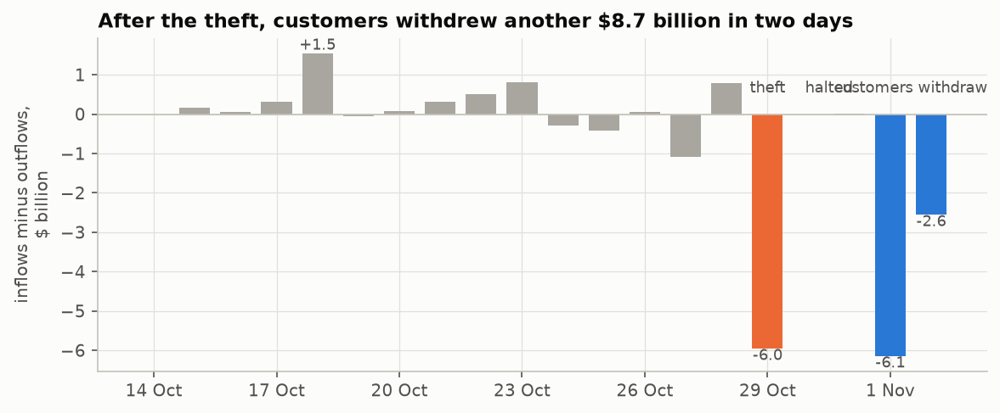

**6. Crypto stocks fell about as much as their exposure predicted.** With Bitcoin measured
from one New York close to the next (-4.95% for the 30 October session, since the hack began after
the 29 October close) and the Nasdaq-100 down 3.5%, a two-factor model fitted on the prior 120
sessions leaves Coinbase at -3.3% abnormal (t = -1.2), Robinhood -0.9%, Circle -0.8% and Strategy
+2.1%: all within normal daily noise. There was no contagion to listed crypto firms, and no
flight to the regulated competitor either. Measuring Bitcoin from midnight to midnight instead
would have shown a spurious -6.7% for Coinbase.

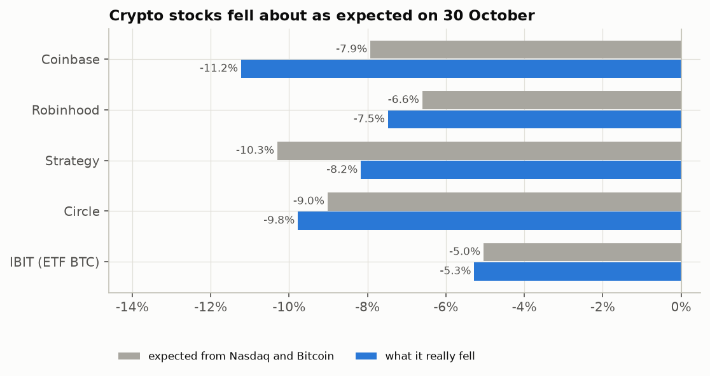

**7. Fifteen years of exchange hacks: no average effect on Bitcoin, and this one is an outlier
only in size.** Across the 36 hacks of centralized exchanges of $30 million or more in
DefiLlama's register since 2011, Bitcoin's standardized abnormal return over the incident day and
the next averages -0.17 (placebo p = 0.15 against random dates); half are negative. The Binance
hack ranks 3rd of 36 (-5.5% abnormal over two days, -1.96 sd), a move that 3.5% of all two-day
windows match or exceed. Hack size barely predicts the reaction (correlation -0.22).

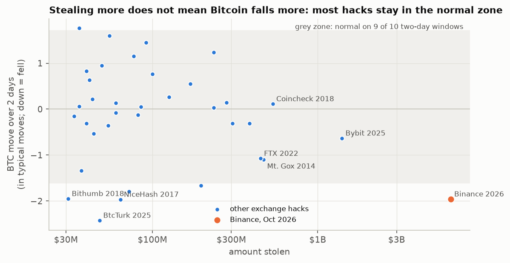

**After: a week, a month and a year.** This hack is too recent to measure at those horizons, but 35 earlier
ones can be measured against random dates of the same year. At a week and a month BTC cannot be told from any other
date; at a year it stands at -10.9% against +15.6%, which is not conclusive (p = 0.12).

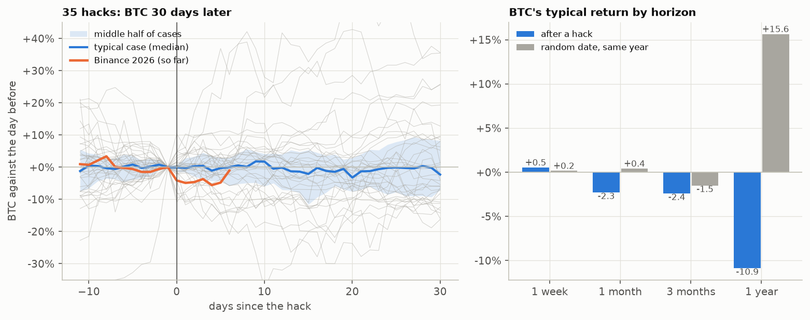

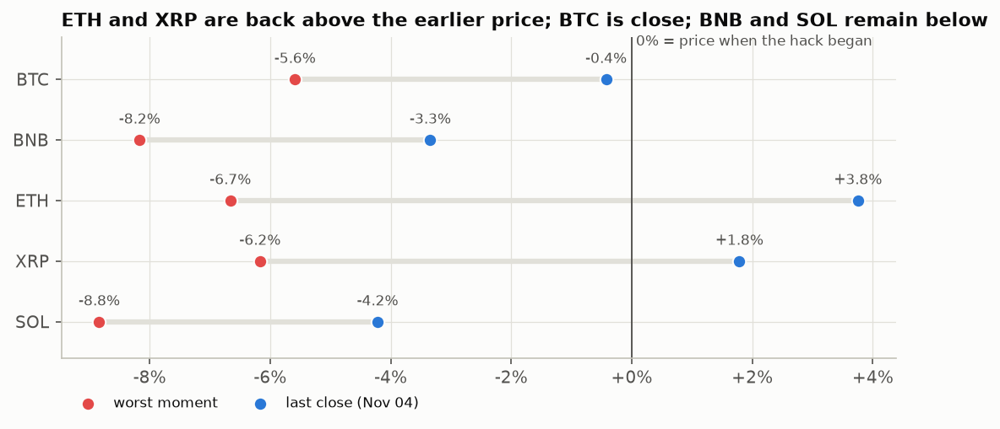

**8. Was the market really in an uptrend?** On 28 October Bitcoin closed at $81,344. It had gained
43% in the third quarter (its 50-day average, $81,943, was above the 200-day, $73,111), but it was
already down 2.7% in October, 7.2% for the year and **16% below its January high** of $96,952. Brent
crude was at $115 after eight months of war in the Gulf and the US 10-year yield near 5%. The
rally was real, but it had stalled before the hack.

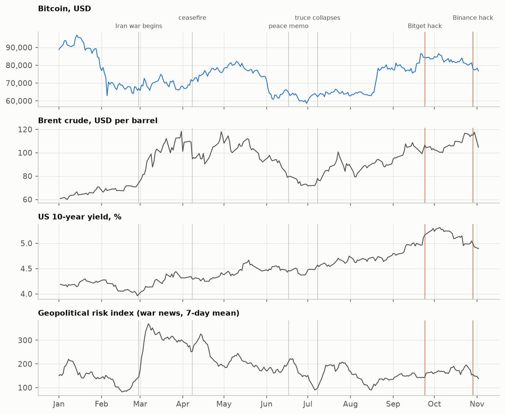

**9. Can machine learning forecast the price with the news?** **Not the price, and the news adds nothing.** I built a daily panel of BTC, ETH, BNB, XRP and SOL since 2019 with 65 features in eight groups: price and volume, futures funding, stocks, rates, dollar and oil, war and policy news indices (geopolitical risk, policy uncertainty), sentiment and attention (Fear & Greed, Wikipedia), on-chain supply (hash rate, stablecoins, Binance reserves), the hack register and the calendar, each lagged as it is published. Every month from January 2022 to November 2026, ridge, LightGBM, quantile LightGBM and an MLP were refitted on what was known that day and forecast the month ahead: 8,830 coin-days.

| Target | Benchmark | Out-of-sample result |
|---|---|---|
| Next-day return | "no change" | R² against zero: LightGBM -0.6%, ridge -1.1%, MLP -1.4%, historical mean -0.3%; direction right on 49.4% to 51.2% of days |
| 7-day return | "no change" | R² LightGBM -2.0%, ridge -3.8% |
| Next-week volatility | HAR (last day, week and month) | HAR explains 19.3% of log volatility; LightGBM 20.3%, 1.2% less error, Diebold-Mariano p = 0.28 |

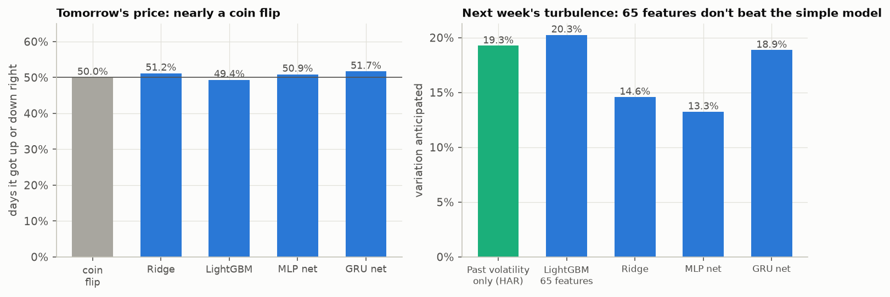

- A long/flat strategy on LightGBM's sign lost to buy-and-hold on all five coins (BTC -48% against +61% holding, after 10 bp per switch).
- The MLP trained at least 100 epochs at every quarterly refit and kept its best validation checkpoint. On returns that checkpoint was always between epoch 1 and 10 (median 1): anything it learned after the first epochs was noise.
- A GRU over the last 20 days, trained at least 100 epochs per quarterly refit with early stopping and checkpointing from epoch 100 (best epoch 100 to 126 on returns), did not help either: R² -1.7% at one day and -12.3% at 7 days, direction right on 51.7% of days; for volatility, as a correction to HAR, 18.9% against 19.3% (Diebold-Mariano p = 0.78). Its best epoch sits at the 100-epoch floor: longer training only added noise.
- Added one group at a time to price and volume (quarterly refits), no group moves the next-day error by more than 0.7%. For volatility, **every news group makes the forecast worse**: stocks and rates +4.2%, on-chain +3.5%, the hack register +3.2%, sentiment +2.7%, war and policy indices +2.4% more error; only futures funding helps (-0.3%). What the war and the news did to prices was already in the prices by the time the indices came out.
- The 90% bands are honest on average (they covered 89.2% of next-day moves and 86.2% of 7-day ones) and they did not see the hack coming: for 29 October BTC's band was -3.0% to +3.7% and it fell 4.1%; BNB's was -3.2% to +4.2% and it fell 8.1%. All five coins closed below their bands.

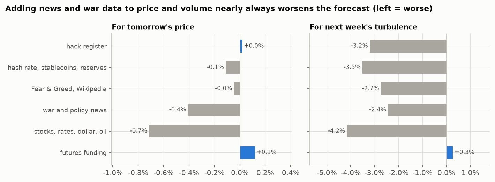

**10. Today's forecast.** Refitted on everything resolved by the close of 2 November 2026 and applied to that day:

| Coin | Close 2 Nov | 3 Nov: median (90% band) | 9 Nov: median (90% band) | Expected daily volatility next week (last 30 days) |
|---|---|---|---|---|
| BTC | 76,816 | 76,820 (73,987 - 79,192) | 76,627 (68,088 - 86,972) | 1.87% (1.52%) |
| ETH | 2,253 | 2,253 (2,167 - 2,329) | 2,252 (1,997 - 2,538) | 2.07% (1.90%) |
| BNB | 699.25 | 699.18 (670.40 - 721.39) | 698.01 (619.80 - 786.69) | 2.12% (2.11%) |
| XRP | 1.2502 | 1.2498 (1.2016 - 1.2917) | 1.2494 (1.1082 - 1.4018) | 2.11% (2.33%) |
| SOL | 91.98 | 92.05 (87.62 - 95.53) | 92.02 (81.12 - 105.07) | 2.69% (2.21%) |

The medians are "no change", as the evaluation says they should be; the information is in the width of the band. The volatility model expects more turbulence than in the last 30 days for BTC, ETH and SOL. In its TreeSHAP breakdown price and volume features dominate; the war and policy indices and the hack register each move the forecast by less than 0.01 in log volatility. A GitHub Action scores this forecast against each new daily close; the record is on the [live page](https://rxyxs.github.io/binance-hack-market-impact/).

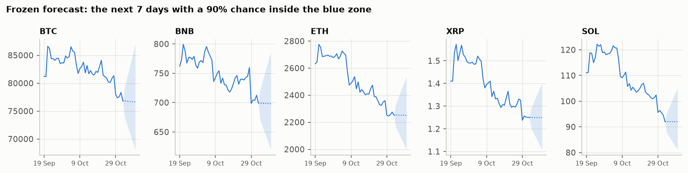

**11. Where the price can go.** Ranges built from pieces of each coin's own historical moves, with no trend
added. It is not a prediction: BTC at a month 67,752 - 97,839 and at a year 37,696 - 173,735 dollars (90%). Tested from every month
since 2020 on earlier data, the 90% range held 84% at 7 days and 88% at a year.

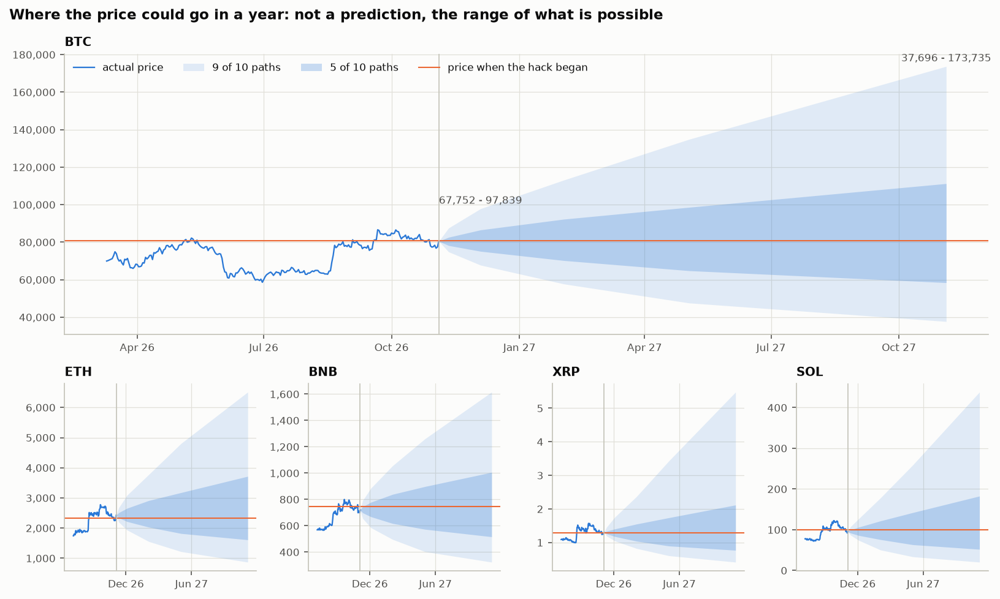

## By year

Bitcoin on Binance spot (BTCUSDT only; Binance also lists BTC against other stablecoins):

| Year | Return | Volatility (annual) | Max drawdown | Volume, $bn | Trades/day, k | Buyer-initiated |
|---|---|---|---|---|---|---|
| 2017 (from 17 Aug) | +221.9% | 110% | -34.9% | 7 | 31 | 51.9% |
| 2018 | -73.0% | 84% | -81.2% | 96 | 239 | 51.3% |
| 2019 | +94.3% | 68% | -49.4% | 121 | 359 | 50.9% |
| 2020 | +302.0% | 81% | -53.6% | 286 | 859 | 48.8% |
| 2021 | +59.8% | 81% | -53.1% | 1,154 | 1,838 | 49.2% |
| 2022 | -64.2% | 64% | -66.9% | 1,199 | 3,289 | 49.6% |
| 2023 | +155.6% | 44% | -20.0% | 920 | 2,566 | 49.5% |
| 2024 | +121.3% | 53% | -26.2% | 850 | 2,774 | 49.6% |
| 2025 | -6.3% | 42% | -32.0% | 767 | 3,736 | 48.4% |
| 2026 (to 2 Nov) | -12.4% | 44% | -39.5% | 401 | 3,561 | 49.4% |

Money stolen in crypto per year (DefiLlama hack register, all targets):

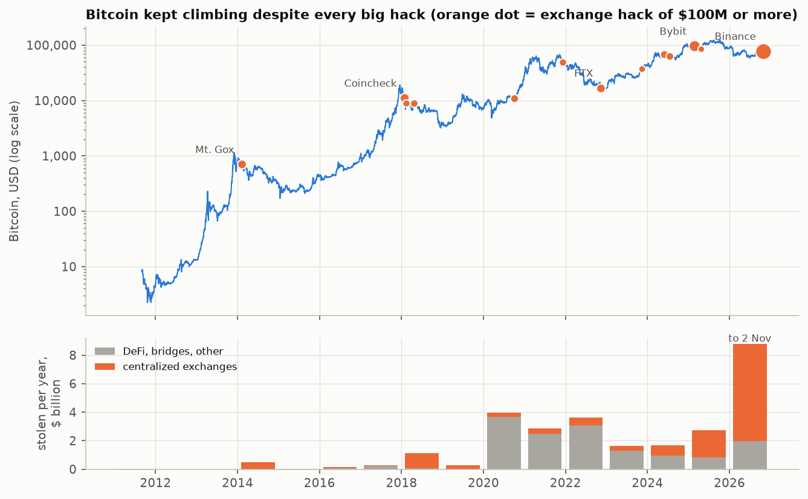

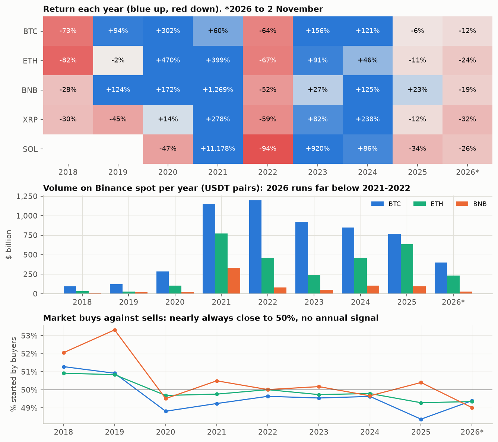

2026 is already the worst year on record at **$8.78 billion** to 2 November, $6.82 billion of it from
centralized exchanges; the Binance hack alone is 72% of the year.

## Method

```
data.binance.vision ─ daily klines 2017-2026 (22 coins), 1-minute klines and every trade
                      22 Oct - 2 Nov, perpetual futures, open interest, funding
Coinbase, OKX        ─ 1-minute prices, same window, to compare venues
Yahoo Finance        ─ 1-minute Nasdaq-100 futures, dollar, gold, oil, crypto stocks (frozen
                      in data/snapshot/: Yahoo keeps minute bars for 30 days only)
Bitstamp             ─ Bitcoin daily since 2011 (hacks before Binance existed)
DefiLlama            ─ register of 1,336 hacks; Binance wallet holdings per token; stablecoins
FRED, Iacoviello GPR ─ rates, inflation expectations, credit spreads, policy uncertainty, and a
                      daily geopolitical risk index built from war and terrorism news
alternative.me, Wikimedia, blockchain.com ─ Fear & Greed, page views, hash rate
        │
        ├── annual.py      year-by-year returns, volume, buyer share; hacks per year
        ├── eventstudy.py  36 exchange hacks, standardized abnormal returns, placebo dates
        ├── intraday.py    the night: paths, hack vs Nasdaq, cross-section, flows, venues,
        │                  open interest, reserves, crypto stocks
        ├── detector.py    market-data alarm, calibrated on 60 days, held out on 30, tested on 2019
        ├── features.py    daily panel: 65 features in 8 groups, each lagged as it is published
        ├── forecast.py    monthly walk-forward 2022-2026: ridge, LightGBM, quantile LightGBM with
        │   nn.py          split-conformal bands, MLP; Diebold-Mariano tests; feature-group ablation
        └── nowcast.py     the same models refitted on everything, applied to the last day
```

Event times come from TRM Labs' on-chain reconstruction and the public timeline, with a source
per row in [`data/catalog/hack_timeline.csv`](data/catalog/hack_timeline.csv). The news-driven
inputs are the Caldara-Iacoviello geopolitical risk index (counts of war and terror articles in
ten newspapers), the Baker-Bloom-Davis policy uncertainty index, Wikipedia page views, the Fear &
Greed index and DefiLlama's hack register. GDELT was the first choice for news, but its archive has
a hole exactly over the hack: when I queried it on 3 November 2026, the number of articles it
monitored fell from about 150,000 a day to 2,000-5,000 from 26 October, and the days from 28 October
to 2 November were missing.

## Limits

- One event. The minute-level findings describe this hack; the event study is what generalizes.
- The Nasdaq model explains 37% of Bitcoin's five-minute variance in a calm week. A crash can
  raise betas, which would credit even more of the fall to the Nasdaq, not less.
- Stolen amounts and event times are from TRM Labs and press reports; Binance has not published
  a post-mortem. DefiLlama dates hacks by day, not by hour, so the event study uses two-day windows.
- DefiLlama only sees wallets Binance has published, and FRED now serves only three years of the
  ICE high-yield spread, so that feature is missing before 2023.
- Nothing here is investment advice. The forecast section shows how little daily prices can be
  predicted, which is the opposite of a trading signal.

## Reproduce

```bash
pip install -r requirements.txt
PYTHONPATH=src python -m bhack.run      # downloads ~300 MB, then about 45 minutes on 16 cores
pytest -q
```

The pipeline writes [`reports/results.json`](reports/results.json), the figures in
`docs/img/` and the page in `docs/index.html`.

## Sources

- TRM Labs, [North Korea steals USD 6.36 billion from Binance](https://www.trmlabs.com/resources/blog/north-korea-steals-usd-6-36-billion-from-binance-in-the-largest-hack-in-history) (on-chain timeline and amounts)
- [2026 Binance hack](https://en.wikipedia.org/wiki/2026_Binance_hack), Wikipedia; [CryptoTicker timeline of the night](https://cryptoticker.io/en/crypto-crash-binance-hack-timeline-liquidations/); [StealthEX timeline](https://stealthex.io/blog/binance-hack-everything-we-know-about-the-6-3b-theft/)
- [CNBC markets live blog, 29-30 October 2026](https://www.cnbc.com/2026/10/29/stock-market-today-live-updates.html); [2026 Strait of Hormuz crisis](https://en.wikipedia.org/wiki/2026_Strait_of_Hormuz_crisis), Wikipedia
- Caldara and Iacoviello, [Geopolitical Risk Index](https://www.matteoiacoviello.com/gpr.htm); [DefiLlama hacks](https://defillama.com/hacks); [Binance public data](https://data.binance.vision)

## License

MIT, see [LICENSE](LICENSE).
